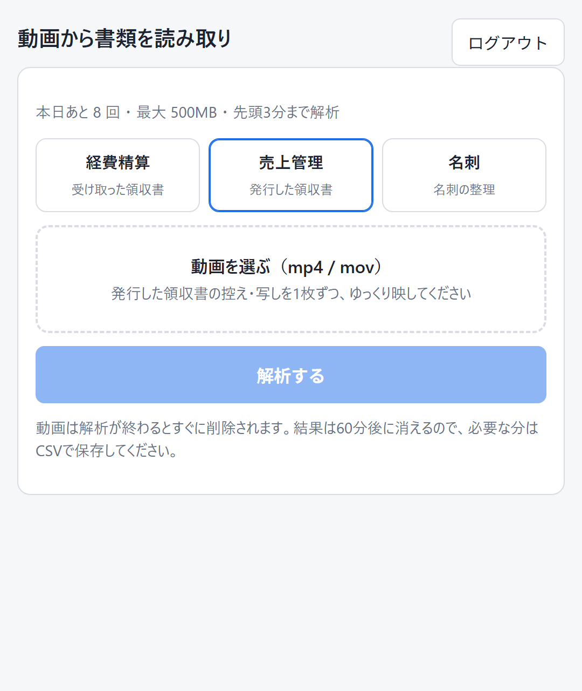
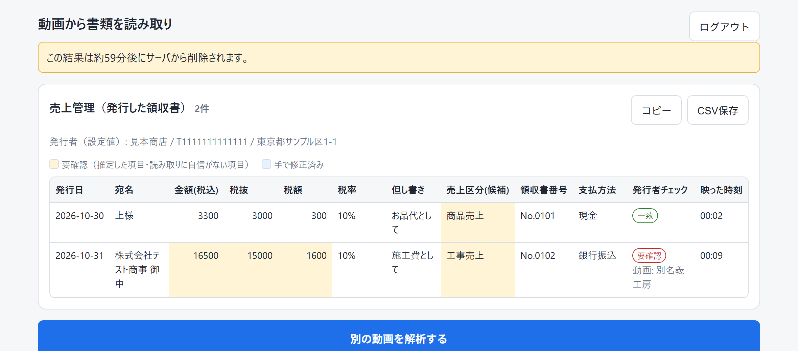

# 動画から領収書・名刺をデータ化（プロトタイプ）

[](https://github.com/oranegewimps/video-receipt-ocr/actions/workflows/test.yml)

スマホで撮った動画（最長3分）をアップロードすると、映っている書類を読み取り、表とCSVで返します。身内数人で試すための最小版です。

読み取る書類は、アップロード画面で3つのモードから選びます。直前に選んだモードは、そのブラウザで次回の既定値になります。

| モード | 用途 | 主な項目 |
|---|---|---|
| `expense` 経費精算 | 受け取った領収書・レシート・請求書 | 日付、勘定科目（候補）、支払先、金額、インボイス登録番号 |
| `sales` 売上管理 | 自分が発行した領収書の控え・写し | 発行日、宛名、金額（税込・税抜・税額）、税率、但し書き、売上区分（候補）、領収書番号、支払方法 |
| `bizcard` 名刺 | 名刺 | 会社名、氏名、役職、部署、住所、電話、メール |

| アップロード（スマホ幅） | 結果（売上管理モード） |
|---|---|
|  |  |

画面の値は mock モードの架空のサンプルです。

## 特徴

- **動画1本を1回のAPI呼び出しで解析**します。同じ書類が複数のフレームに映っても1件にまとめ、モデル側で統合しきれなかった重複はアプリ側でも番号や金額などの一致で統合します。
- **推測させない**：読めない項目は null にします。勘定科目・売上区分だけは推定を許し、推定した値は「要確認」として黄色で表示します。
- **検証つき**：インボイス登録番号の形式チェック（任意で国税庁APIの照合）、発行者情報と設定値の照合、税抜＋税額＝税込の確認をします。
- **表で直してから出力**：セルを手で修正でき、CSV保存（Excel対応）とクリップボードへのコピーができます。
- **残さない**：動画は解析の成否にかかわらず削除し、Gemini 側のファイルも削除します。サーバ側の保存も無効（`store=False`）にしています。結果はメモリ上に60分だけ保持します。
- **費用を数える**：ジョブごとにトークン数と概算費用を記録し、日次の回数上限（失敗も数える）を設けています。
- **mock モード**：外部通信なしで固定のサンプルを返すので、APIキーなしで画面やテストを動かせます。

## 構成

- バックエンド: Python 3.12 + FastAPI
- フロント: 素の HTML/JS 1ページ（`static/index.html`）
- AI: Gemini API（`app/extractor.py` の `extract(video_path, mode) -> dict` に閉じ込めてあります）。プロンプトとJSONスキーマはモードごとに `app/schema.py` にあります。

## 1. セットアップ（Windows）

### ffmpeg

```powershell
winget install --id Gyan.FFmpeg -e
```

インストール後は**ターミナルを開き直して**ください（PATH が反映されます）。`ffprobe -version` が動けばOKです。
PATH を通せない場合は、`.env` の `FFMPEG_BIN` / `FFPROBE_BIN` にフルパスを書いてください。

### Python 環境

```powershell
git clone https://github.com/oranegewimps/video-receipt-ocr.git
cd video-receipt-ocr
python -m venv .venv
.\.venv\Scripts\pip install -r requirements.txt
copy .env.example .env   # その後 .env を編集
```

### 起動

```powershell
.\.venv\Scripts\python -m uvicorn app.main:create_app --factory --host 127.0.0.1 --port 8000
```

ブラウザで http://127.0.0.1:8000 を開き、`INVITE_CODES` に設定したコードでログインします。
スマホから試す場合は `--host 0.0.0.0` で起動し、同じLANから `http://<PCのIP>:8000` にアクセスします（Windows ファイアウォールの許可が必要です）。

> ジョブと結果はプロセスのメモリ上にあるため、`--workers` は 1 のまま使ってください。再起動すると処理中のジョブと結果は消えます。

### テスト

```powershell
.\.venv\Scripts\python -m pytest -q
```

Gemini はモックか偽クライアントで置き換えるので、外部通信も課金も発生しません。テスト動画は ffmpeg のテストパターンから生成します（個人情報は含みません）。

## 2. 環境変数

詳細は [.env.example](.env.example) を参照してください。主なもの：

| 変数 | 既定 | 説明 |
|---|---|---|
| `GEMINI_MODE` | `mock` | `mock`=固定のサンプル結果を返す（外部通信なし）、`live`=Gemini API を呼ぶ |
| `GEMINI_API_KEY` | – | live で必須。コード・ログには出しません |
| `GEMINI_MODEL` | `gemini-3.8-flash` | 使うモデル |
| `GEMINI_MEDIA_RESOLUTION` | 空（API既定） | `low`/`medium`/`high`/`ultra_high`。小さい文字が読めないときに上げる（トークン増） |
| `GEMINI_FPS` | `1` | 1秒あたりのサンプリングフレーム数 |
| `GEMINI_THINKING_LEVEL` | `low` | 思考の深さ |
| `GEMINI_TIMEOUT_SEC` / `GEMINI_MAX_ATTEMPTS` | `300` / `3` | 1回あたりのタイムアウトと最大試行回数（429/5xx などで再試行） |
| `STRIP_AUDIO` | `true` | 音声を除去してから送る（約32トークン/秒の節約） |
| `GEMINI_PRICES` | 公式料金 | 概算費用の単価（USD/100万トークン） |
| `INVITE_CODES` | – | `ラベル:コード` をカンマ区切りで |
| `DAILY_LIMIT_PER_USER` / `DAILY_LIMIT_TOTAL` | `10` / `50` | 1日の解析回数の上限（日本時間で日付を区切る）。**失敗したジョブも数えます** |
| `RESULT_TTL_MIN` | `60` | 解析結果の保存期間 |
| `WORK_DIR` | `%TEMP%\video-receipt-ocr` | 一時ファイルの置き場所。OneDrive 配下を指定すると起動を拒否します |
| `NTA_APP_ID` | – | 国税庁インボイスWeb-APIのアプリケーションID（任意。経費精算モード・live の時だけ照合） |
| `SELF_NAME` / `SELF_INVOICE_NO` / `SELF_ADDRESS` | – | 売上管理モードの発行者情報。表・CSVの発行者欄はこの値を使います。登録番号は T＋13桁（違うと起動時にエラー） |
| `SALES_CATEGORIES` | 既定の候補 | 売上区分の候補（カンマ区切り） |

## 3. 処理の流れ

1. `POST /api/jobs?mode=expense|sales|bizcard` に動画をリクエストボディのまま送ります（multipart を使わないので、一時ファイルの複製ができません）。サイズ上限（500MB）を超えた時点で受信を打ち切ります。
2. ffprobe で形式（mp4/mov）・映像トラック・長さを検証します。
3. 日次上限を確認し、使用量DBに1件記録します（この時点で1回と数えるので、失敗しても回数に入ります）。ジョブIDを返します。
4. バックグラウンドで処理します。
   - ffmpeg（再エンコードなし）で先頭3分に切り詰め、音声を除去します。キーフレームの位置によって1秒ほど長くなることがあります。
   - `extract(video, mode)` → Gemini（Files API でアップロード → モード別スキーマで構造化出力 → Gemini 側のファイルを削除）
   - モード別の重複排除（モデル側での統合に加え、次の一致でまとめる）
     - 経費精算：金額・日付・支払先
     - 売上管理：領収書番号（なければ金額・日付・宛名）
     - 名刺：メール（なければ氏名・会社名）
   - モード別のチェック
     - 経費精算：登録番号の形式チェック（T+13桁）と、国税庁APIによる照合（任意）
     - 売上管理：発行者の照合。動画に写った発行者名・登録番号が設定値と食い違えば「要確認」にします。発行者名は部分一致を許容します。あわせて、税抜＋税額が税込と合わない場合は金額3項目を「要確認」にします。
   - **finally でジョブの作業ディレクトリを削除**します。
5. フロントは2秒ごとに `GET /api/jobs/{id}` をポーリングし、完了するとモードに応じた列の表を表示します。セルは手で修正でき、CSV保存（UTF-8 BOM付き、Excel対応）とクリップボードへのコピー（TSV）ができます。売上管理モードのCSVには、発行者名・登録番号・住所（設定値）の列も付きます。

読めない項目は、推測させずに null にしています。ただし勘定科目（経費精算）と売上区分（売上管理）は、業種や但し書きから推定してよいことにし、推定した場合は「要確認」にさせています。「要確認」の項目は黄色、手で直した項目は青で表示します。

## 4. 削除と安全性

| 対象 | 削除のタイミング |
|---|---|
| アップロードされた動画・前処理後の動画 | ジョブの `finally` で作業ディレクトリごと削除（成否を問わない）。受け付けなかった場合はリクエスト処理の `finally` で削除 |
| Gemini Files API 上の動画 | `extract()` の `finally` で `client.files.delete()`。取り残しは掃除処理が「表示名 `vro-` で始まり30分以上前」のものを削除（もともと48時間で自動削除されます） |
| Gemini 側のリクエスト・応答 | Interactions API は**既定でサーバ側に保存する（`store=True`）**ので、`store=False` を明示しています |
| 解析結果 | メモリ上のみ。60分で失効し、掃除処理で破棄 |
| 古い一時ファイル | 起動時に作業ディレクトリを丸ごと空にし、その後は5分ごとに30分以上前のものを削除 |

- ログに出すのはジョブID・サイズ・長さ・所要時間・トークン数だけです。抽出内容は出しません。httpx のリクエストURLログ（国税庁APIのアプリIDを含む）は抑止しています。
- 使用量DB（`data/usage.db`）にもトークン数などしか保存しません。
- **ストレージ側のバージョニング・ソフトデリート（ローカル）**：`%TEMP%`（`C:\Users\<user>\AppData\Local\Temp`）は OneDrive の同期対象外です。`shutil.rmtree` はごみ箱を経由しません。Windows の「ファイル履歴」は既定では AppData を対象にしません（独自にバックアップ設定を足している場合は `WORK_DIR` を除外してください）。Cloud Storage のバージョニング無効化はフェーズ2で設定します。

### 削除の確認方法

```powershell
.\.venv\Scripts\python scripts\check_tmp.py           # 作業ディレクトリに何も残っていないか
.\.venv\Scripts\python scripts\check_tmp.py --gemini  # （live 時）Gemini 上の取り残しも確認。外部通信あり
dir $env:TEMP\video-receipt-ocr\uploads               # 直接見てもよい
```

解析中は `uploads\<ジョブID>\input.mp4`・`prepared.mp4` があり、完了後は空になります。

## 5. 精度とコストの測定

```powershell
# samples\ に動画（と任意で <名前>.expected.json）を置く
# --mode は書類モード（expense / sales / bizcard）、--gemini-mode は mock / live の上書き
.\.venv\Scripts\python scripts\evaluate.py samples\ --mode sales --gemini-mode mock   # 外部通信なしで動作確認
.\.venv\Scripts\python scripts\evaluate.py samples\ --mode sales --models gemini-3.8-flash,gemini-3.5-flash-lite   # 2モデル比較（課金あり・実行前に確認）
.\.venv\Scripts\python scripts\usage_report.py --days 30            # アプリ経由の実績
```

- `evaluate.py` は、動画1本ごとに入力・出力・思考トークン数、動画1分あたりの入力トークン数、概算費用（USD・円）を出します。正解JSONがあれば、書類の検出漏れ・余分な検出・項目一致率も出します。結果は `eval_results\eval_<日時>.csv` に指標だけを書きます（抽出内容は `--save-output` を付けたときだけ保存）。
- 管理用エンドポイント：`GET /admin/usage?days=7`（ヘッダ `X-Admin-Token`）
- 費用の目安（公式資料からの概算。実測値で確認してください）：映像はフレームあたり約258トークン（low では66）で、1fps・3分なら入力は約4.6万トークンです。gemini-3.8-flash なら1本あたり約$0.035＋出力分です。
- 出力が文字化けする場合は PowerShell で実行するか、`$env:PYTHONUTF8=1` を設定してください。

正解JSONの例（売上管理モード、`samples\sales1.expected.json`）。項目名は `--mode` のスキーマと同じです。値が入っている項目だけを採点します。

```json
{"documents": [
  {"issue_date": "2026-10-30", "customer_name": "上様", "amount_total": 3300, "purpose": "お品代として", "receipt_no": "No.0101"}
]}
```

## 6. Gemini API（2026-11-02 に確認）

- **SDK**: `google-genai` **2.34.0**（PyPI 最新、Python ≥3.11）
- **モデル**: `gemini-3.8-flash`（[モデル一覧](https://ai.google.dev/gemini-api/docs/models)で Stable 表記の Flash 系の最新）。比較候補は `gemini-3.6-flash`（Stable）と `gemini-3.5-flash-lite`（Stable、安価）。`gemini-3-flash-preview` などの preview 版は使いません。
- **料金**（[料金表](https://ai.google.dev/gemini-api/docs/pricing)、有料枠、USD/100万トークン）：3.8-flash / 3.6-flash は入力 0.75・出力 3.75（**2027-01-01 から 1.50 / 7.50 に値上げ予定**）。3.5-flash-lite は 0.30 / 2.50。有料枠のデータはプロダクト改善に使われない、と記載されています。
- **API の選択**：公式ドキュメントの動画理解・構造化出力の例は Interactions API（`client.interactions.create`）に移っているため、それに合わせました。`generate_content` も SDK には残っています。

使っている呼び出し（`app/extractor.py`）：

```python
client = genai.Client(api_key=..., http_options=types.HttpOptions(
    timeout=300_000, retry_options=types.HttpRetryOptions(attempts=3)))

# 1) 動画のアップロード（Files API）→ ACTIVE になるまで待つ（FAILED/タイムアウトで中断）
f = client.files.upload(file=path, config={"mime_type": "video/mp4", "display_name": "vro-xxxx"})
f = client.files.get(name=f.name)  # state.name == "ACTIVE" まで

# 2) JSONスキーマ指定の構造化出力
it = client.interactions.create(
    model="gemini-3.8-flash",
    input=[{"type": "video", "uri": f.uri, "mime_type": f.mime_type,
            "processing": {"type": "static", "fps": 1}},
           {"type": "text", "text": prompt(mode, settings)}],
    response_mime_type="application/json",
    response_format={"type": "text", "mime_type": "application/json", "schema": response_schema(mode)},
    generation_config={"thinking_level": "low"},
    store=False,            # 既定 True（サーバ保存）を無効化
    timeout=300.0,
)
data = json.loads(it.output_text)
it.usage.total_input_tokens, it.usage.total_output_tokens, it.usage.total_thought_tokens

# 3) 削除
client.files.delete(name=f.name)
```

- スキーマ（`app/schema.py`）は null 許容を `"type": ["string", "null"]` で表します（ドキュメントの対応範囲内）。出力は JSON として正しい形式で返りますが、値の検証はアプリ側で行います。
- 参照：[動画理解](https://ai.google.dev/gemini-api/docs/video-understanding) / [Files API](https://ai.google.dev/gemini-api/docs/files) / [構造化出力](https://ai.google.dev/gemini-api/docs/structured-output)
- 引数名などはインストール済み SDK のソース（`_gaos/types/interactions/*.py`）でも確認しました。

## 7. インボイス登録番号

- 形式チェック：全角→半角、空白・ハイフンを除去して `^T\d{13}$`。
- 国税庁 適格請求書発行事業者公表システム Web-API（任意）：`NTA_APP_ID` があり、かつ live モードのときだけ `https://web-api.invoice-kohyo.nta.go.jp/1/num?id=…&number=T…&type=21&history=0`（JSON）で照合し、「登録あり／未登録／失効」を表示します。仕様は[公式ページ](https://www.invoice-kohyo.nta.go.jp/web-api/index.html)の仕様書（第二編）に基づきますが、アプリIDがないため実際の通信は未確認です。

## 8. 既知の制約

- ジョブはメモリ管理なので、プロセスは1つで動かす前提です（Cloud Run ではフェーズ2で方式を決めます）。
- 3分での切り詰めは再エンコードしないため、数秒の誤差があります。
- 実 API での確認は、短いテスト動画数本だけです。精度と費用は、数本の動画で `evaluate.py` を使って測り直す必要があります。
- フェーズ2（Cloud Run へのデプロイ：署名付きURLでの Cloud Storage への直接アップロード、Secret Manager など）は未着手です。

## ライセンス

[MIT](LICENSE)
